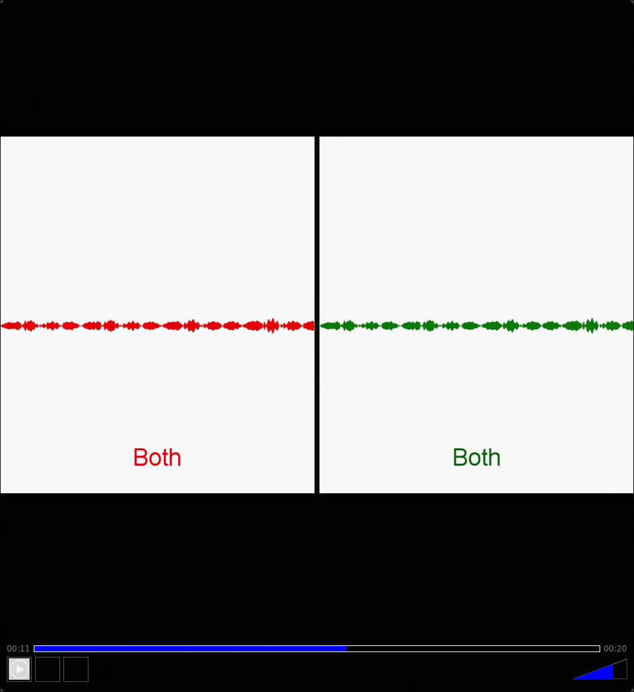
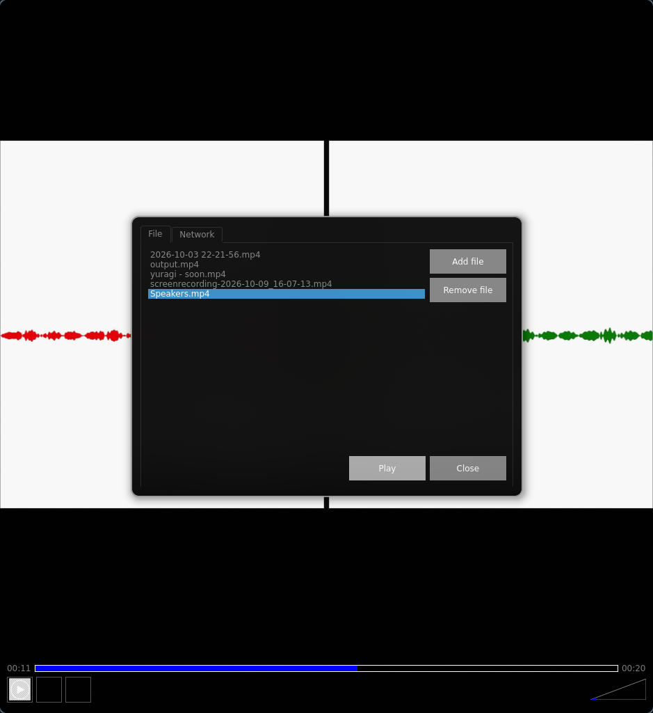

# FFEditor


A lightweight desktop media player built with **C++**, **Qt** and **FFmpeg**. It is the foundation of a future video editor: the playback core is done, and GPU acceleration and editing tools are coming next.





## Key Features

*   **Wide Format Support:** Plays common video and audio formats through FFmpeg, including **AV1** (via libdav1d).
*   **Accurate A/V Sync:** Audio is the master clock, and video follows it.
*   **Precise Seeking:** Draggable playhead with time shown on the video and on the timeline (`00:00:00`). Seeking snaps to the nearest I-frame.
*   **Playlist:** Open several files at once, switch between them and remove items.
*   **Any Audio Layout:** The channel count is detected from the file, with hardcoded stereo.
*   **Playback Controls:** Play, pause, stop, reset and volume control.
*   **Predictable Memory Usage:** Packet and frame queues are limited by size in KB, so heavy streams don't blow up RAM.

## Technical Stack

*   **Language:** C++
*   **Framework:** Qt (without Qt Multimedia)
*   **Decoding:** FFmpeg (libavcodec, libavformat, libswresample), libdav1d for AV1
*   **Audio Output:** [miniaudio](https://miniaud.io)
*   **Architecture:** Separate threads for demuxing, video decoding, audio decoding and rendering, connected by templated packet/frame queues
*   **Environment:** Linux (Windows: `planned`)

## Roadmap

*   [x] Video and audio playback with A/V sync
*   [x] Seeking, playlist, volume control
*   [x] AV1 support (software decoding via libdav1d)
*   [ ] GPU-accelerated decoding and rendering
*   [ ] Trimming and cutting

## Downloads & Releases

You don't need to build the app from source to try it out. Ready-to-run builds are available in the **Releases** section:

*   **Linux:** Standalone AppImage. Make it executable and run it:
```bash
    chmod +x FFEditor-x86_64.AppImage
    ./FFEditor-x86_64.AppImage
```

 **[Download the latest release here](https://github.com/Ryeheck/FFEditor/releases)**

## How to Build and Run

### Prerequisites
You need a C++ compiler, CMake, Qt 6 and FFmpeg (built with libdav1d). `nasm is required if you build FFmpeg from source.`

```bash
# Clone the repository
git clone https://github.com/Ryeheck/FFEditor.git
cd FFEditor

# Configure and Build
cmake -B build -S .
cmake --build build

# Run the application
./build/FFEditor
```

## Feedback

Found a bug or have an idea? Open an [issue](https://github.com/Ryeheck/FFEditor/issues).